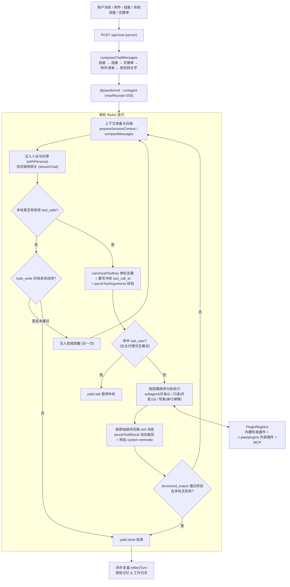

# Paw 技术架构与运行时设计

本文档详细介绍 Paw 的分层架构、ReAct 主循环、工具调度、防死循环护栏、五层上下文管理、子代理运行时以及本机数据与配置约定。

---

## 1. Monorepo 分层与 `@paw/kernel`

Paw 将 Agent 运行时内核与宿主服务解耦，采用 pnpm Monorepo 组织：

| 包 / 目录 | 职责 |
| --- | --- |
| `kernel/` (`@paw/kernel`) | **零运行时依赖的 Agent 核心**：ReAct 循环（`loop.ts`）、因果并发与护栏、工具结果三档裁剪（`prune.ts`）、上下文估算与检查点压缩（`context.ts` / `session-context.ts`）、会话交接（`handoff.ts`）、子代理运行时（`subagent.ts` / `agents.ts`）、声明式插件注册表（`plugin.ts`） |
| `shared/` (`@paw/shared`) | 前后端共享的数据契约（`AgentEvent`、`ContentBlock`、`ChatMessage`、`ToolSchema`、跨轮历史序列化等） |
| `server/` (`@paw/server`) | 本地 Hono + SSE 宿主服务：OpenAI 兼容网关客户端、SQLite 持久化、标准内置插件、外置插件动态加载与热重载、MCP 客户端、通用 HTTP 系统连接、工作区文件系统与 PTY 终端、定时任务调度、Office 预览引擎 |
| `web/` (`@paw/web`) | React + Vite 前端：流式对话与工具卡片、Monaco IDE + xterm 终端、可拖拽侧栏菜单、插件自定义页面容器与各管理页 |
| `desktop/` (`@paw/desktop`) | Electron 桌面壳（macOS），负责窗口管理、桌面通知与本地服务生命周期 |



---

## 2. ReAct 主循环与因果并发调度

实现于 [`kernel/src/loop.ts`](../kernel/src/loop.ts)（宿主适配在 [`server/src/agent/loop.ts`](../server/src/agent/loop.ts)）：

1. **运行期上下文冻结**：每次 `runAgent` 启动即固定 `workspace`、`signal`、`depth`、`allowedTools`、`sessionId`、`parentSessionId`、`connectionCode`、`unattended`、`outputSchema`，整轮工具调用复用同一份上下文。
2. **网关容错与超时**：[`server/src/gateway/client.ts`](../server/src/gateway/client.ts) 对首包前的 `429` / `5xx` 或网络抖动等待 `1000ms` 自动重试一次；首包超时 `180s`，流式空闲超时 `300s`。
3. **归一化去重与参数校验**：`canonicalToolKey` 递归排序参数并剔除展示字段 `summary`，自动过滤同轮幻觉重复调用；重写冲突 `tool_call_id`；`parseToolArguments` 拒绝非对象或被截断的 JSON 参数。
4. **因果分批并发调度**：
   - **连续 `subagent` 调用** → 并发池（上限 `4`），通过 `AsyncQueue` 实时透传子代理事件；
   - **连续只读工具**（插件中声明 `meta.readOnly: true`）→ 滚动并发池（上限 `10`），先统一 `tool_start` 再按完成顺序 `tool_done`；
   - **写类 / 有状态工具** → 单独作为**顺序屏障**串行执行，避免 `read → edit → run` 等操作乱序。
5. **特殊控制流**：主对话交互模式支持 `ask_user` 暂停等待回答；`todo_write` 有未完成项时收尾前催促一次；子代理 `structured_output` 校验通过且同轮无错时提前收尾。

---

## 3. 轮次预算与防死循环护栏

核心原则：**不用「压低轮次」防死循环**。压低轮次上限会误杀大型代码审查与重构任务；Paw 采用「高轮次兜底 + 非阻断重复/失败提醒 + 实时结果裁剪」的组合策略：

| 护栏维度 | 机制与参数 |
| --- | --- |
| **主循环轮次预算** | 默认 `MAX_ROUNDS = 200`（`PAW_MAX_ROUNDS` 可覆盖，最低 `4`）；剩余 2 轮预警，耗尽以 `__LIMIT__` 友好收尾 |
| **连续整轮重复检测** | 排除 `todo_write` 后比较归一化调用签名，连续第 **3 / 5 / 8** 次注入非阻断提醒 |
| **乒乓死循环检测** | 滑动窗口 `recentCallCounts` 累计 **4 / 6 / 9** 次触发提醒；一旦有 `meta.mutating` 工具执行成功即清空窗口 |
| **连续工具失败检测** | 连续失败第 1 轮提示分析错因或转后台执行，连续 ≥2 轮提示重新核查路径、schema 与假设 |
| **提醒挂载方式** | 统一以 `<system-reminder>` 追加在最后一条 `role: 'tool'` 消息末尾，不伪造 `role: 'user'` 干扰摘要器 |

---

## 4. 五层上下文管理与会话交接

1. **提示词与输入组装**：[`server/src/persona.ts`](../server/src/persona.ts) 按 `mtime` 缓存加载 `~/.paw/persona/`（可选）+ 证据纪律 + 执行手册 + 工作区/技能/子代理/记忆索引；[`server/src/chat-input.ts`](../server/src/chat-input.ts) 按固定顺序追加选中技能、系统连接、交接单、附件清单与视觉转文字结果。
2. **单轮工具结果实时裁剪**（[`kernel/src/prune.ts`](../kernel/src/prune.ts)）：对 `meta.prunable: true` 工具及所有 MCP 工具按本轮并发大结果数量动态切分三档（`<=2`: `10k/2k`、`3~4`: `6k/1.5k`、`>=5`: `2.5k/700` 留头留尾），前端卡片保留全文。
3. **80% 窗口自动压缩与检查点**（[`kernel/src/context.ts`](../kernel/src/context.ts) / [`kernel/src/session-context.ts`](../kernel/src/session-context.ts)）：窗口 `1,000,000` tokens，阈值 `80%`，按完整 `assistant(tool_calls) + tool` 原子组切分前缀，二分分块滚动摘要，并以 SHA-256 `prefixDigest` 持久化检查点到 `context_checkpoints`。
4. **跨轮历史保真**（[`web/src/lib/store.ts`](../web/src/lib/store.ts) / [`shared/src/index.ts`](../shared/src/index.ts)）：不回传旧思维链；最近 4 轮保留精简后的真实 `(assistant[tool_calls] + tool)` 对；更早轮次只保留最终结论。
5. **会话交接（Handoff）与按需回查**（[`kernel/src/handoff.ts`](../kernel/src/handoff.ts) / [`server/src/tools/parent-session.ts`](../server/src/tools/parent-session.ts)）：确定性工程状态快照（改动文件、未完待办、运行中常驻服务）+ 目标导向 LLM 摘要生成交接单；新会话自动解锁 `search_parent_session`，平时 0 上下文开销，需要时按需回查源会话。

---

## 5. 子代理设计

子代理采用 **Markdown + YAML frontmatter** 三层加载（`server/agents/*.md` → `~/pawagent/*.md` → `<workspace>/.pawagent/*.md`，同名后者覆盖前者），内置 [`code-explorer`](../server/agents/code-explorer.md) 与 [`code-review`](../server/agents/code-review.md)。

定义示例：

```markdown
---
name: code-explorer
description: 只读代码库探查专员
tools: list_dir, search_file, search_content, read_file, web_search
model: inherit
---
（子代理的 system prompt 正文）
```

- **双模式上下文**：默认 `spawn` 独立上下文；可选 `fork: true` 携带截断后的父对话。
- **硬安全边界**：schema 与执行入口双层校验工具白名单；永久剔除 `subagent` 并限制 `depth < 1` 防递归；强制 `unattended: true` 拒绝 `ask_user`。
- **结构化输出与落库**：支持 `output_schema` JSON Schema 校验；执行过程实时透传到父对话卡片，并以 `source: 'subagent'` 持久化到 SQLite 供随时点开复查。

---

## 6. 本机数据目录与环境变量

所有用户个人数据与运行时状态均存放在 `~/.paw/`（可通过 `PAW_DATA_DIR` 覆盖），重装应用不丢失：

| 路径 | 用途 |
| --- | --- |
| `~/.paw/gateway-config.json` | 网关地址 `GATEWAY_URL` 与密钥 `GATEWAY_KEY`（`0600` 权限，登录页自动写入） |
| `~/.paw/paw.db` | SQLite 数据库（会话、检查点、记忆、工作日志、定时任务与运行记录） |
| `~/.paw/plugins/` | 外置动态插件目录及启停/私有配置 `plugins.json` |
| `~/.paw/persona/` | 可选个人人设与长期记忆文件（`IDENTITY.md` / `SOUL.md` / `USER.md` / `MEMORY.md`） |
| `~/.paw/connections.json` & `secrets.json` | 系统连接定义与独立密钥文件（`0600` 权限，密钥永不进模型上下文） |
| `~/.paw/search-config.json` & `search-key.txt` | 内置 `web_search` 渠道（DeepSeek / DuckDuckGo）与密钥 |
| `~/.paw/office/editor_sdk` | 本地 Office 预览引擎（若仓库/包内缺失，首次预览或打包时按需从 `PAW_OFFICE_URL` 下载） |

### 环境变量

| 环境变量 | 说明 |
| --- | --- |
| `GATEWAY_URL` | 网关根地址（自动追加 `/v1/chat/completions`）。优先读 `~/.paw/gateway-config.json`，其次本环境变量，默认 `https://api.inspurai.cc`。 |
| `GATEWAY_KEY` | 网关 API Key。优先读 `~/.paw/gateway-config.json`，其次本环境变量；均未配置时启动后显示登录页。 |
| `PAW_MODEL` | 默认模型名（默认 `qwen4-max`）。 |
| `PAW_DATA_DIR` | 覆盖默认数据目录 `~/.paw`。 |
| `PAW_PLUGINS_DIR` | 覆盖默认外置插件目录 `~/.paw/plugins`。 |
| `PAW_SKILLS_DIR` | 覆盖默认技能目录 `~/.paw/skill`。 |
| `PAW_MAX_ROUNDS` | 覆盖主循环最大工具轮次（默认 `200`，最低 `4`）。 |
| `SUBAGENT_TIMEOUT_MS` | 覆盖单个子代理超时毫秒数（默认 `1800000`，即 30 分钟）。 |
| `PAW_OFFICE_URL` / `PAW_OFFICE_BIN` | 覆盖 Office 预览引擎下载地址或本地二进制路径；设 `PAW_OFFICE_AUTO_DOWNLOAD=0` 可关闭运行时自动下载。 |
