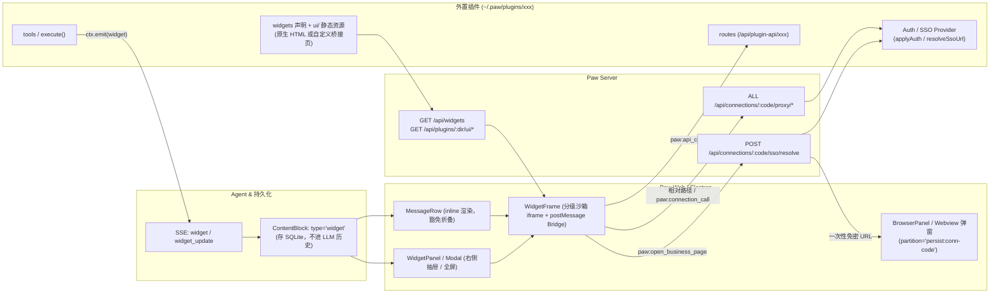

# Paw 自定义组件（Chat Widgets）架构设计方案

本文档定义 PawAgent 在会话流与侧边/弹窗容器中渲染**自定义交互组件**的通用技术方案，覆盖运行时隔离、双向通信、系统连接自动代理、可选 SSO 插件扩展点，以及主仓库与外置插件的职责边界。

---

## 1. 目标与核心原则

1. **框架无关、零打包门槛**：部件只需是一个普通静态 HTML 页（支持原生 JS / React / Vue / Web Components 等任意技术栈），不强制宿主打包规范。
2. **安全隔离优先**：默认通过沙箱 `iframe` 隔离部件崩溃、样式与脚本，不把第三方部件直接 `import` 到 Paw React 主窗口上下文。
3. **易于桥接既有 Web 组件产物**：支持通过自定义 HTML 桥接页（配合查询参数）加载 UMD / ESM / Web Component 等第三方组件产物。
4. **复用系统连接与可选 SSO 扩展**：部件代码不写域名、不碰密钥、不操心 CORS；外部接口自动复用 Paw「系统连接」，页面跳转默认直接拼接 `baseUrl` 打开，若安装了外置 SSO 插件则自动接入换票。
5. **通用底座进主仓，业务能力进插件**：保持 Paw 主仓库开源通用，与具体业务场景彻底解耦。

---

## 2. 主仓库 vs 外置插件的职责边界

自定义组件体系采用 **「主仓库提供通用运行时底座 + 外置插件提供具体部件与协议实现」** 的分层方式：

| 归属 | 负责内容 | 说明 |
| --- | --- | --- |
| **Paw 主仓库（内核与通用底座）** | • `shared/`：`WidgetBlock`、`AgentEvent`、Bridge 协议契约<br>• `server/`：`ServerPawPlugin.widgets` 注册托管、`GET /api/widgets`、连接原始代理 `/api/connections/:code/proxy/*`、`ConnectionSsoProvider` 标准换票钩子与 `/api/connections/:code/sso/resolve`<br>• `web/`：`WidgetFrame`（分级沙箱 iframe + Bridge）、`WidgetPanel`（右侧抽屉/全屏 + Electron `<webview>` 弹窗）、`MessageRow` 渲染与轮次折叠豁免 | 一次性接入 Paw 主工程，所有插件共享 |
| **外置插件（`~/.paw/plugins/`）** | • 具体的自定义部件（静态 HTML 页或自带桥接页的 UMD / Web Component 产物）<br>• 触发部件的 Agent 工具（`tools`）与专属后端接口（`routes`）<br>• 自定义认证提供器（`registerAuthProvider`）与 SSO 换票提供器（`registerSsoProvider`） | 独立演进、支持热重载，无需重新编译 Paw 主仓库 |

---

## 3. 总体架构



---

## 4. 详细设计

### 4.1 插件契约与托管（`server/`）

在 `ServerPawPlugin`（`server/src/plugins/types.ts`）的 `pages` 旁边新增 `widgets?: PluginWidgetSpec[]`：

```ts
export interface PluginWidgetSpec {
  /** 插件内唯一 ID，全局 key 为 `${pluginName}:${id}` */
  id: string;
  /** 默认卡片标题 */
  title?: string;
  /** 用途描述（可供管理页展示或注入模型提示词） */
  description?: string;
  /** 相对插件目录的静态入口（如 'ui/chart.html' 或 'ui/bridge.html?script=./dist/widget.umd.js'）或 https:// URL */
  entry: string;
  /** 默认展示位：消息流内嵌或右侧面板 */
  placement?: 'inline' | 'panel';
  /** inline 模式初始高度（px），默认 240 */
  defaultHeight?: number;
  /** inline 模式高度钳制上限（px），默认 800（宿主全局硬上限 2000） */
  maxHeight?: number;
  /** 默认 false（受限沙箱）；仅本机插件可显式开启同源模式，远程 URL 禁止开启 */
  sameOrigin?: boolean;
  /** 兜底绑定的系统连接 code */
  defaultConnection?: string;
  /** 允许访问的系统连接范围：默认 'session'（仅限该卡片绑定的单条连接），或显式白名单 */
  allowedConnections?: 'session' | string[];
  /** 若组件本身即远端业务页面，挂载前是否先走 SSO 换票 */
  sso?: boolean;
}
```

- **静态资源托管**：复用 `/api/plugins/:dir/ui/*`，保留原有 `..` 路径穿越拦截；解析 `entry` 时保留 `?query` 透传（便于桥接页接收脚本路径等参数）。
- **清单接口**：新增 `GET /api/widgets`，返回所有已启用插件解析后的 `ResolvedPluginWidget[]`，前端启动及插件热重载时同步更新。

---

### 4.2 数据流、持久化与上下文隔离（`shared/`）

#### SSE 事件（`AgentEvent`）
```ts
| {
    type: 'widget';
    id: string;                              // 部件实例唯一 ID（同 id 可被 widget_update 增量更新）
    widgetId: string;                        // 全局 key，格式 `${pluginName}:${id}`
    title?: string;
    placement?: 'inline' | 'panel';
    connectionCode?: string;                 // 绑定的系统连接 code
    data?: unknown;                          // 小数据直接内联（建议 <= 100 KB）
    dataRef?: string;                        // 大数据引用 ID，挂载后按需拉取
    options?: Record<string, unknown>;       // 部件渲染配置项（如 mode / theme / 自定义选项）
    autoOpen?: boolean;                      // placement === 'panel' 时是否自动展开右侧面板
  }
| {
    type: 'widget_update';
    id: string;
    data?: unknown;
    options?: Record<string, unknown>;
    status?: 'streaming' | 'ready';
  }
```

#### 消息块（`ContentBlock`）
```ts
| {
    type: 'widget';
    id: string;
    widgetId: string;
    title?: string;
    placement?: 'inline' | 'panel';
    connectionCode?: string;
    data?: unknown;
    dataRef?: string;
    options?: Record<string, unknown>;
    /** 用户在部件内操作后回写的持久化交互态（刷新不丢） */
    state?: unknown;
    status?: 'streaming' | 'ready';
  }
```

#### 三条核心数据纪律
1. **工具主动发射为主通道**：工具在 `execute(args, toolCallId, ctx)` 中通过 `ctx.emit({ type: 'widget', ... })` 推送，不污染 Markdown 正文，不依赖模型手写大 JSON。
2. **LLM 历史上下文严格隔离**：跨轮序列化发给模型的 `ChatMessage[]` **跳过 `type === 'widget'` 块**（绝不把 `widget.data` / `widget.state` 塞进模型上下文），模型仅基于对应 `tool` 返回的精简摘要继续推理。
3. **大数据走 `dataRef` 防膨胀**：大体积结构化数据（如长表格、文档解析结果等）由插件侧缓存，事件里只传 `dataRef`；部件挂载后通过插件 API 按需拉取，避免撑爆 SQLite 与 `localStorage`。

---

### 4.3 前端容器、展示位与安全沙箱（`web/`）

#### 双展示位
- **`inline`（消息流内嵌）**：`MessageRow.tsx` 新增 `block.type === 'widget'` 分支，渲染 `WidgetCard`（轻量顶栏：标题 + 刷新 +「在右侧展开」，主体为 `WidgetFrame`）。
- **`panel`（右侧面板 / 全屏）**：复用 `BrowserPanel` / `IdePanel` 的右侧可拖拽分栏模式，新增 `WidgetPanel`。消息流中仅留一张轻量摘要卡片（标题 + 状态 +「查看」按钮），支持 `autoOpen` 自动展开与一键全屏。

#### 豁免轮次折叠（`turnFold`）
`MessageRow.tsx` 在回复结束后默认将“最后一段 `text` 之前的所有块”收入折叠条。需显式将 `type === 'widget'` 标记为**成果块（不参与 `turnFold` 折叠）**，确保工具执行期间发射的部件在回复结束后依然完整可见。

#### 分级沙箱与安全护栏

| 模式 | `iframe sandbox` 属性 | 适用场景 | 安全校验 |
| --- | --- | --- | --- |
| **默认（受限沙箱）** | `sandbox="allow-scripts allow-forms"` | 原生 HTML 部件、第三方插件、远程 URL | 无 `allow-same-origin`，无法接触宿主 DOM；业务请求走宿主 `postMessage` 代理 |
| **同源模式（`sameOrigin: true`）** | `sandbox="allow-scripts allow-forms allow-same-origin"` | 强依赖同源环境的本机插件（如 Web Worker、PDF 渲染器、自定义桥接页） | **仅允许本机插件目录资源**；远程 `http(s)://` 强制忽略 `sameOrigin` |

同时在宿主侧落实通用校验：
- **精确来源校验**：每条 `postMessage` 必须同时满足 `ev.source === iframeRef.current?.contentWindow`、`protocol === 'paw-widget/1'`、`from === 'widget'` 与 `ev.data.instanceId === block.id`，防止多张卡片串台和部件伪造宿主消息。
- **高度钳制（Clamp）**：`resize` 消息的 `height` 必须限制在 `[80, Math.min(spec.maxHeight ?? 800, 2000)]` 内，防止异常或恶意部件把页面撑爆。
- **调用预算**：单次调用载荷 ≤ 64KB、15 秒超时、每张卡片最多 8 个在途调用；超限直接回 `ok:false`，组件卸载/刷新时 `AbortSignal` 一并终止在途请求，**不采用超时乐观放行**。

---

### 4.4 统一 `postMessage` Bridge 协议

所有消息统一封装为：
```ts
interface WidgetBridgeEnvelope {
  protocol: 'paw-widget/1';       // 版本门禁，不匹配直接丢弃
  channel: 'paw-widget';
  from: 'widget' | 'host';        // 宿主只接受 widget 发来的消息
  instanceId: string;             // ready 首帧可为空
  requestId?: string | number;    // api_call / connection_call 必填，响应按它关联
  type: string;
  payload?: unknown;
}
```

| 方向 | `type` | 载荷与语义 |
| --- | --- | --- |
| 部件 → 宿主 | `ready` | 部件脚本就绪，请求宿主推送初始数据（避免单纯依赖 `iframe.onload` 的时序竞态） |
| 宿主 → 部件 | `init` | `{ instanceId, sessionId, messageId, connectionCode, theme, mode, data, dataRef, options, state }` |
| 宿主 → 部件 | `update` | `{ data?, options?, theme?, status? }`（流式增量更新、主题切换） |
| 部件 → 宿主 | `resize` | `{ height: number }`（宿主钳制后动态调整 inline iframe 高度） |
| 部件 → 宿主 | `api_call` | `{ method, path, headers?, body? }` + 信封 `requestId` → 宿主代发 `/api/plugin-api/<pluginName>/<path>` 并回传 `api_result`（响应信封带同一 `requestId`） |
| 部件 → 宿主 | `connection_call` | `{ method, path, headers?, body?, responseType? }` + 信封 `requestId` → 宿主自动拼上该部件绑定的 `connectionCode`，代发 `/api/connections/<code>/proxy/<path>` 并回传 `connection_result` |
| 部件 → 宿主 | `open_business_page` | `{ path, query?, title?, mode?: 'browser_panel' \| 'modal' }` → 宿主解析目标 URL（默认 `<baseUrl> + path`；若已安装外置 SSO 插件则自动换票）后在内置浏览器或弹窗打开 |
| 部件 → 宿主 | `send_message` | `{ text: string }`（将用户操作转为下一条用户消息发给 Agent，类似 `AskCard`） |
| 部件 → 宿主 | `save_state` | `{ state: unknown }`（持久化交互态到 `ContentBlock.state`） |
| 部件 → 宿主 | `open_panel` / `close_panel` | 在 inline 与右侧 `WidgetPanel` 之间切换 |

---

### 4.5 系统连接复用（组件不写域名）

#### 1. `connectionCode` 绑定优先级（并固化到 `ContentBlock`）
1. 工具发射 `widget` 事件时显式传入的 `connectionCode`；
2. 当前对话消息选中的 `ctx.connectionCode`；
3. `PluginWidgetSpec.defaultConnection`。

固化到 `ContentBlock.connectionCode` 后，历史会话刷新或用户在其他会话切换系统连接时，旧卡片依然准确请求当时绑定的外部系统。

#### 2. 服务端原始透传代理
- 在 `server/src/connections.ts` 抽取底层 `fetchConnectionRaw(code, opts)`：完整复用 `baseUrl` 拼接、防 SSRF 域名/路径前缀锁死、敏感头剥离（`Authorization` / `Cookie` / `Host`）、以及 `auth` / `ConnectionAuthProvider` 密钥注入；**保留原始状态码、`Content-Type` 与二进制流（不做 16k 截断）**，满足文件下载、二进制预览与大 JSON 需求。
- 在 `server/src/index.ts` 注册 `ALL /api/connections/:code/proxy/*`。
- **作用域收敛**：通过校验请求携带的部件绑定关系（或白名单 `allowedConnections`），阻止未授权部件跨连接探测 `connections.json` 中的其他系统。

#### 3. 部件侧零域名写法
- **原生部件**：直接调用 `connection_call` Bridge 传相对路径（如 `/api/v1/items`），由宿主自动拼接所绑定的系统连接。路径只允许普通相对片段：scheme、`//host`、`..`、`%2e`、`%5c`、反斜杠一律拒绝，宿主还会断言最终 URL 落在 `/api/plugin-api/<plugin>/` 或 `/api/connections/<code>/proxy/` 前缀内。
- **桥接第三方 Web 组件**：若插件通过自定义桥接页加载外部构建的组件包，可在桥接页加载组件前对 iframe 内的 `fetch` / `XMLHttpRequest` 做轻量相对路径重写，自动转发至 `/api/connections/<connectionCode>/proxy<path>`。

---

### 4.6 页面打开与可选 SSO 扩展点（外置插件实现）

> **说明**：与 `docs/connections.md` 一致，**Paw 核心仓库不内置任何具体的 SSO 换票实现**。未安装 SSO 插件时，所有功能均开箱可用：页面跳转默认直接拼接 `<conn.baseUrl> + <path>` 打开（Electron `<webview>` 会自动保留用户手动登录后的 Cookie）；仅当用户安装了外置 SSO 插件并为连接配置了 `sso` 时，才触发插件提供的自动换票逻辑。

为便于外置插件按需接入免密登录，在 `ConnectionSsoProvider`（`server/src/connections.ts`）上预留两个**可选钩子**（未实现时自动回退到默认行为）：

```ts
export interface ConnectionSsoProvider extends ConnectionSsoProviderView {
  promptHint?: string;
  normalize?(sso: Record<string, unknown>, code: string): ConnectionSso;

  /** 可选（页面/弹窗级）：由外置插件将业务相对路径换票为免密直达 URL */
  resolveSsoUrl?(ctx: {
    conn: Connection;
    secret: string | null;
    targetPath?: string;
    query?: Record<string, string>;
  }): Promise<{
    url: string;
    partition?: string; // 默认 `persist:conn-${conn.code}`
    title?: string;
  }>;

  /** 可选（接口级）：由外置插件为只认 SSO 会话态的接口注入凭据 */
  applySsoAuth?(ctx: ConnectionAuthContext): Promise<void> | void;
}
```

运行时行为：
1. **弹窗 / 打开业务页面（`POST /api/connections/:code/sso/resolve`）**：
   - 若连接配置了 `sso` 且对应外置插件实现了 `resolveSsoUrl` → 调用插件换票返回免密 URL；
   - **否则（无 SSO 插件的默认路径）** → 直接按 `<conn.baseUrl> + targetPath + query` 安全拼接（含防 SSRF 校验）返回目标 URL。
   - Electron 桌面端统一用 `<webview partition="persist:conn-${code}">` 打开（不受 `X-Frame-Options` 限制，且弹窗与 `BrowserPanel` 共享同一连接登录态，不同连接间 Cookie 隔离）；纯 Web 浏览器模式若遇目标站点禁止 iframe 嵌入，自动降级为新标签页打开。
2. **部件调业务接口（`/api/connections/:code/proxy/*`）**：
   - 优先走连接自身配置的通用 HTTP 认证（`none` / `bearer` / `header` / `basic` / `query`）或外置 `ConnectionAuthProvider`；
   - 若同时配置了外置 SSO 插件且实现了 `applySsoAuth`，则在转发上游前额外回调该钩子。

---

## 5. 插件开发示例

```js
// ~/.paw/plugins/paw-plugin-chart-widget/index.mjs
export default function createChartWidgetPlugin() {
  return {
    name: 'chart-widget',
    version: '1.0.0',
    widgets: [
      {
        id: 'summary-card',
        title: '数据概览',
        entry: 'ui/summary-card.html',
        placement: 'inline',
        defaultHeight: 260,
      },
      {
        id: 'detail-viewer',
        title: '详情审阅',
        entry: 'ui/detail-viewer.html',
        placement: 'panel',
      },
    ],
    tools: [
      {
        schema: {
          name: 'render_summary',
          description: '渲染数据概览卡片',
          parameters: {
            type: 'object',
            properties: { title: { type: 'string' }, items: { type: 'array' } },
            required: ['items'],
          },
        },
        meta: { readOnly: true },
        async execute(args, toolCallId, ctx) {
          ctx.emit?.({
            type: 'widget',
            id: `w_${toolCallId}`,
            widgetId: 'chart-widget:summary-card',
            title: String(args.title || '数据概览'),
            connectionCode: ctx.connectionCode,
            data: { items: args.items },
          });
          return `已渲染数据概览卡片，共 ${Array.isArray(args.items) ? args.items.length : 0} 条记录。`;
        },
      },
    ],
  };
}
```

---

## 6. 改动文件清单与分阶段落地路线

### 涉及主仓库文件
| 包 / 文件 | 改动摘要 |
| --- | --- |
| `shared/src/index.ts` | 新增 `WidgetBlock`、`AgentEvent`（`widget` / `widget_update`）、`WidgetBridgeEnvelope`；确认历史序列化跳过 `widget` 块 |
| `server/src/plugins/types.ts` | 新增 `PluginWidgetSpec`、`ResolvedPluginWidget`，扩展 `ServerPawPlugin.widgets` |
| `server/src/plugins/loader.ts` | 解析、校验并热重载 `widgets` 清单（保留 `?query` 与路径防穿越） |
| `server/src/connections.ts` | 抽取 `fetchConnectionRaw`；扩展 `ConnectionSsoProvider`（`resolveSsoUrl` / `applySsoAuth`） |
| `server/src/index.ts` | 新增 `GET /api/widgets`、`ALL /api/connections/:code/proxy/*`、`POST /api/connections/:code/sso/resolve` |
| `web/src/components/WidgetFrame.tsx` | 新建：分级沙箱 iframe + `postMessage` Bridge + 高度钳制 + API/连接代理 |
| `web/src/components/WidgetPanel.tsx` | 新建：右侧可拖拽/全屏展开面板 + Electron `<webview partition>` 业务弹窗 |
| `web/src/components/MessageRow.tsx` | 渲染 `block.type === 'widget'`，并豁免 `turnFold` 折叠 |
| `web/src/App.tsx` | 消费 `widget` / `widget_update` 事件，挂接 `WidgetPanel`、`send_message`、`save_state` 与 `open_business_page` |

### 分阶段实施计划
- **Phase 1（核心底座 MVP）**：
  - `shared` 契约 + `server` 插件 `widgets` 注册与 `GET /api/widgets`。
  - `web` 实现 `WidgetFrame`（分级沙箱、`ready`/`init`/`resize` 钳制）+ `MessageRow` 渲染并豁免 `turnFold`。
  - 用一个最小原生 HTML 示例插件跑通端到端闭环。
- **Phase 2（系统连接代理 + 右侧面板 + 流式更新）**：
  - 实现 `fetchConnectionRaw` 与 `/api/connections/:code/proxy/*`，打通 `connection_call` 与 `dataRef`。
  - 实现 `WidgetPanel` 右侧面板/全屏展开与 `widget_update` 流式更新。
- **Phase 3（页面打开 / 可选 SSO 扩展点 + 双向交互闭环）**：
  - 扩展 `ConnectionSsoProvider` 可选钩子（`resolveSsoUrl` / `applySsoAuth`）与 `/api/connections/:code/sso/resolve`（无插件时默认直接拼接 `baseUrl + path`），接入 Electron `<webview partition>` 弹窗与 `BrowserPanel` 共享登录态。
  - 补齐 `send_message` / `save_state` / 主题同步，按需增加通用 `render_widget` 内置工具并更新 `docs/plugin-development.md`。
